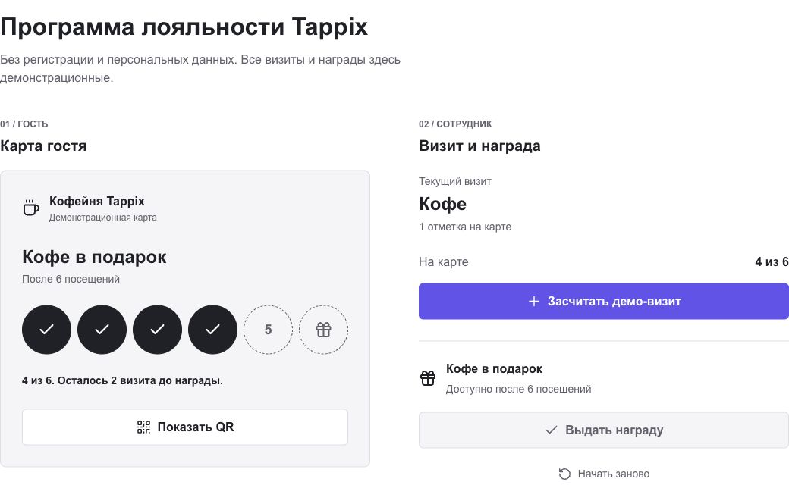
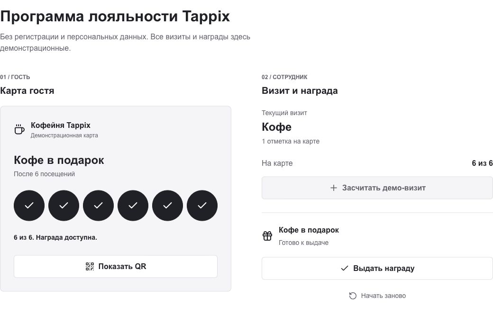
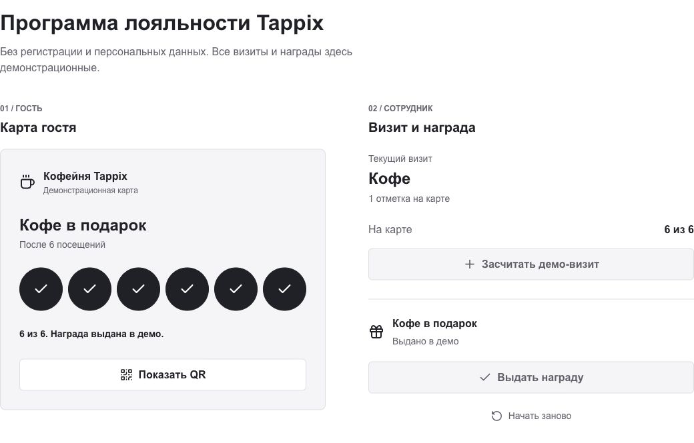
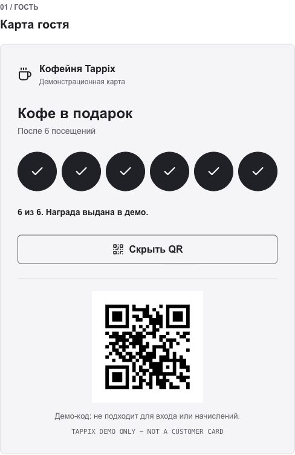
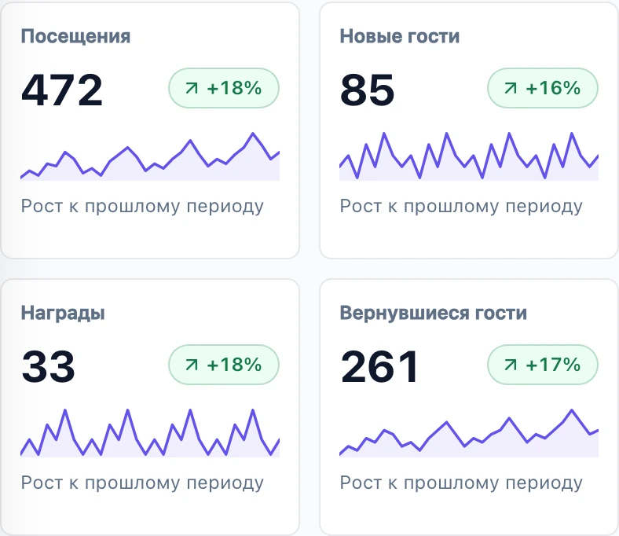
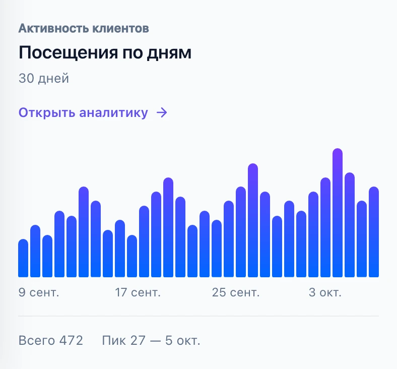

# Статический прототип Tappix

[DIP-13](https://tappix-diploma.youtrack.cloud/issue/DIP-13), 24.10.2026.
Цель: обсудить основной сценарий без разработки нового приложения.
Это изображения существующего прототипа, а не реализация в новом репозитории.
Все показанные значения демонстрационные. Прототип не доказывает корректность
начислений, изоляцию данных, безопасность QR или эффект для бизнеса.

## Граница первой версии

Оставлены карта гостя, прогресс посещений, действие сотрудника, выдача награды
и простые показатели владельца. Исключены из визуального прототипа рулетка,
партнёрства, кампании, платные рассылки, POS-интеграции, сложные отчёты и биллинг.
Гостевой кошелёк и административное подключение остаются требованиями проекта,
но отдельные экраны для них в этой версии не представлены. Фото персональных
аккаунтов и скриншоты реальных баз клиентов не использованы.

## Сценарий

### P01 Карта до награды

Гость видит четыре подтверждённых визита из шести. Сотрудник видит текущее состояние
и действие отметки. Награда недоступна до порога. В демо оба представления рядом
для объяснения; в целевой системе роли разделены проверками сервера.

### P02 Награда доступна

После двух демонстрационных визитов достигнут порог. Доступность награды выражена
текстом и состоянием кнопки, не только цветом. Настоящая выдача должна проверять
условие на сервере заново; кнопка не является защитой от повторного запроса.

### P03 Награда выдана

После выдачи повторное действие недоступно. Это визуальный референс терминального
состояния демо. Для новой реализации требуется определить переход к следующему
циклу, отмену ошибочной операции и журнал. «Начать заново» относится только к демо
и не должен удалять реальную историю.

### P04 Идентификация карты

QR специально содержит тестовое сообщение, не credential и не действующую ссылку
доступа. В реальном сценарии сотрудник сканирует карту в своей компании;
чужая карта должна давать понятный отказ без раскрытия данных другого заведения.

### P05 Показатели владельца

Сокращённый фрагмент существующего демонстрационного обзора. Числа и проценты не
взяты из пилота. В новой реализации нужны явный период, фильтр филиала, определения
метрик и состояние «нет данных». Обозначение «вернувшиеся» уточняется по методике
оценки; сумма карточек на экране не служит проверкой расчёта.

### P06 Динамика посещений

Референс одного графика за период. Для проверки пригодности владельцу нужно
попросить объяснить изменение посещений и найти день максимума без подсказки.
Результат такого пользовательского теста ещё не получен.

## Непоказанные состояния

| Условие | Требуемое поведение новой реализации |
| --- | --- |
| Нет сети после отправки | Не обещать успех; повтор с тем же ключом и сверка результата |
| Камера запрещена | Понятная причина и разрешённый альтернативный поиск карты |
| Карта другой компании | Отказ без имени, телефона и прогресса чужого гостя |
| Сессия истекла | Повторный вход, без потери понимания статуса последней операции |
| Награда уже выдана | Показать актуальный статус, не повторять начисление/выдачу |
| Нет событий за период | Нули и объяснение отсутствия данных, не искусственные графики |

## Происхождение и воспроизводимость

P01–P04: снимки `http://localhost:19088/demo` в Chrome 24.10.2026.
Действия: начальные 4/6; два раза «Засчитать демо-визит»; «Выдать награду»;
«Показать QR». Запросы создания реальных клиентов не выполнялись.
P05–P06: готовые демонстрационные изображения существующего Tappix:
`apps/business/public/marketing/overview-v2/mobile-metrics-light.webp` и
`mobile-chart-light.webp`. Перенесены только изображения, не код и не данные БД.
Изображения ИИ не генерировались. Существующий проект и его история не изменены.

Проверено визуально: текст читается, ключевые состояния различимы, демонстрационные
данные помечены. Реальное удобство, камера, API и восстановление доступа этим не
проверены. После ревью макеты могут быть изменены до начала реализации.
