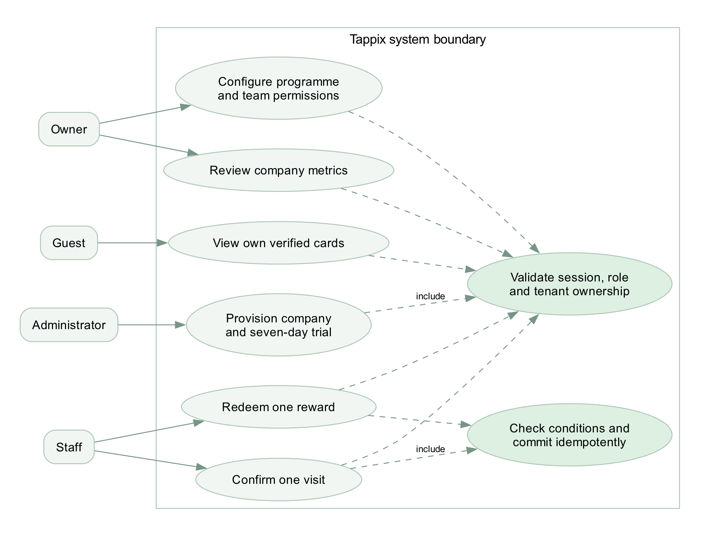
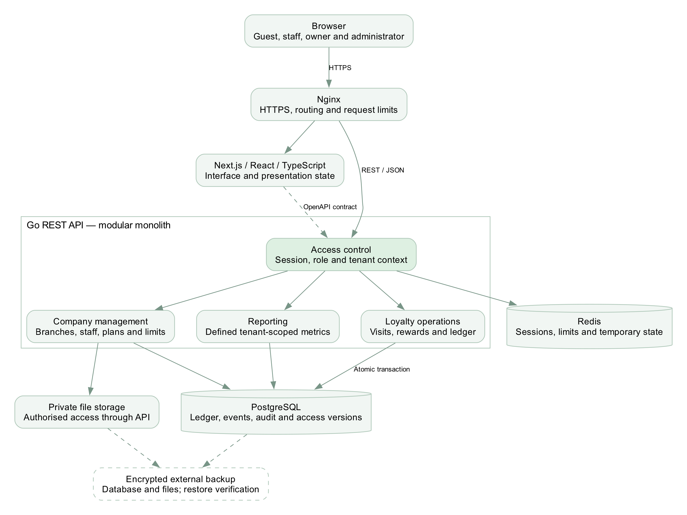

# Tappix first pre-defense report

English edition, 24 October 2026. [PDF](en/Tappix-Pre-Defense-Report-EN.pdf) · [Editable Word](en/Tappix-Pre-Defense-Report-EN.docx).

This source mirrors the report text. Appendices A and B contain unfilled research and supervisor-feedback forms. They do not assert that discussions or approval have occurred.

First pre-defense report

Development of an Information System for Managing Customer Relationships in Small Businesses Through Digital Loyalty Programs.

Armat Islambekov • Yersultan Kambekov
Supervisor: Elvira Aitmukhanbetova
24 October 2026

### Executive summary

We propose a multi-tenant web platform for independent coffee shops, bakeries and salons in Kazakhstan. Guests keep digital loyalty cards, staff record qualifying visits and redeem rewards, and owners review activity within their own company. The platform administrator provisions businesses and assigns plans and a seven-day trial.

This submission defines the problem, evidence, requirements, architecture and evaluation method. Six newly designed static interface concepts illustrate the intended workflow. They are not screenshots of the existing application and do not demonstrate implemented functionality.

The principal engineering question is whether the system can combine company isolation, consistent reward accounting and a usable service-counter workflow. Demand, willingness to pay and sales impact remain hypotheses for real-world evaluation.

### Reading guide

| Part | Pages | Purpose |
| --- | --- | --- |
| Research and scope | 2–6 | Problem, literature, alternatives and technology choices |
| System design | 7–11 | Requirements, safeguards and architecture |
| Concept prototype | 12–15 | Guest, staff, owner and administrator journeys |
| Evaluation and delivery | 16–20 | Experiments, work plan, criteria and references |
| Research records | 21–22 | User discussion protocol and supervisor feedback form |

Status: design package for review. User interviews, substantive supervisor feedback and teammate approval remain outstanding. The existing Tappix implementation is a separate reference project; this report does not claim a new production release.

## 01  Problem and project scope

A limited product scope makes the system testable and keeps the two-student implementation feasible.

### Problem and research question

Paper cards and manually maintained records may leave owners without a consistent history of visits and rewards. Staff may need to resolve lost cards or disputed redemptions, while guests may struggle to understand their progress. These are proposed problems, not findings from interviews with Kazakhstani businesses.

Research question: can a web-based loyalty system provide correct, company-isolated accounting and a clear customer-service workflow that compares favourably with a familiar manual process? The expected contribution is an implemented and reproducibly evaluated information system, not a novel loyalty algorithm.

| User | Primary task | Access boundary |
| --- | --- | --- |
| Platform administrator | Provision companies, plans, limits and trials | Explicit platform permissions with audit records |
| Business owner | Manage programme, branches, team and metrics | Resources of their own company |
| Staff member | Identify a card, confirm a visit, redeem a reward | Assigned company, branch and allowed operations |
| Guest | View own cards, progress and activity | Cards linked through verified identity |

### Objectives and expected outputs

Study relevant literature and actual service-counter behaviour.

Specify roles, data relationships, API contracts and transaction rules.

Implement visits, rewards and a points ledger with idempotent operations.

Evaluate isolation, concurrency, usability, performance and recovery.

Final outputs should include source code, database migrations, an OpenAPI contract, automated tests, deployment and recovery instructions, and an evaluation report. This milestone provides their design basis.

### Included and deferred

The core includes visit-based rewards, loyalty points, displayed discount rules, a guest wallet, owner metrics and administrator-assigned access. Points are programme units rather than money; the wallet does not hold payment cards. Automated billing, POS integrations, mass paid messaging, AI recommendations and native apps are deferred.

## 02  Research foundations

Thematic review • eight scientific studies • access checked in the source register on 24 October 2026

The review uses publisher pages and DOI records for loyalty programmes, digital engagement, reward redemption and customer retention. It is not an exhaustive systematic review. Paywalled papers were considered only through accessible abstracts or excerpts; no full-text access is implied.

### S1  Loyalty programmes have context-dependent effects

Belli et al. (2022) synthesise 429 effect sizes across four decades of loyalty-programme research. Their results distinguish behavioural effects from attitudinal loyalty and indicate variation across programmes and industries. For Tappix, repeat visits and subjective evaluations should be measured separately. A pooled effect is not a forecast for an individual coffee shop. Access: publisher abstract and metadata.

### S2  Programme design and research context matter

Chen, Mandler and Meyer-Waarden (2021) review 131 publications using the theory, context, characteristics and methodology framework. Their review motivates an explicit description of the business segment, reward rules and evaluation method. It does not establish demand in Kazakhstan. Access: abstract and publicly available publisher excerpts.

### S3  Satisfaction is not a causal profit estimate

Mittal et al. (2023) synthesise 535 correlations from 245 articles relating satisfaction to loyalty behaviours and financial outcomes. Associations vary by context and do not establish that deploying Tappix causes profit growth. Our evaluation therefore separates software correctness, usability and potential business effects. Access: abstract and introduction of the open article.

### S4  Rewards are one of several loyalty mechanisms

Liu-Thompkins et al. (2022) analyse 1,908 effect sizes from 319 studies of cognitive, affective and social drivers of retailer loyalty. The broad retail setting limits direct transfer to small service businesses. Staffing, promotions and service quality should be recorded as potential confounders during a pilot. Access: publisher abstract and introduction; bibliographic metadata cross-checked.

### Implication for the project

The literature supports studying loyalty processes. It does not justify treating a digital card, a growing registration count or a positive satisfaction response as evidence of incremental sales.

## 03  Digital engagement and progress

### S5  Redemption and engagement change over time

Son and Oh (2023) examine mobile technology, reward redemption and engagement transitions using transaction-related analyses and complementary research methods. The reported relationships motivate an activity history and longitudinal observation. They do not prove that a web card is superior to a native application. Access: publisher abstract, notes and metadata.

### S6  Point use depends on external conditions

Jin, Kim and Lee (2024) apply logistic and panel regression to company loyalty data before and during the pandemic. Differences between groups and periods caution against reading every change in point spending as improved retention. Tappix should compare similar periods and record contextual changes. Access: abstract and publisher excerpts.

### S7  Feedback and observed behaviour are different evidence

Kuikka et al. (2025; published online in 2024) analyse 45,603 reviews of UK grocery retailers. Semantic evidence helps identify customer concerns, but review language is not the same as observed repeat purchasing. The setting differs from independent businesses in Kazakhstan. Tappix should combine qualitative feedback with recorded events. Access: abstract and research framing of the open article.

### S8  Visible progress has a theoretical basis

Kivetz, Urminsky and Zheng (2006) investigate the goal-gradient hypothesis using field experiments and customer data. This foundational study motivates a visible progress indicator near a reward. Its age and context require renewed evaluation. The design shows actual confirmed visits and does not manufacture progress or promise sales uplift. Access: publisher abstract and the first page of an author-hosted version.

### Research gap and limitations

The applied question is whether independent businesses can use a shared platform without sharing customer records, while staff complete visits and redemptions without developer assistance. No claim of a new theoretical model is made. Before the final defense, the review should be deepened through university library access and complemented with local empirical evidence.

## 04  Existing solutions and alternatives

Comparison method: documentation review of official product pages [P1–P3], not hands-on account testing. “Unverified” does not mean “unavailable”.

| Criterion | Loyverse [P1] | Poster [P2] | Loopy Loyalty [P3] |
| --- | --- | --- | --- |
| Primary workflow | Loyalty within POS | Restaurant POS loyalty | Digital stamp cards |
| Guest enrolment | Name, phone or barcode card | POS entry or customer import | QR or link to mobile Wallet |
| Mechanics | Purchase points and redemption discount | Discounts, bonuses and promotions | Stamps and rewards |
| Staff action | Attach customer to sale | Serve customer at POS | Stamper App |
| Guest view | Points on printed or emailed receipt | Guest web portal unverified | Apple / Google Wallet |
| Analytics | Visits, points and purchase history | Receipts, discounts and guest bonuses | Cards, stamps and rewards |
| Multiple locations | Earn and redeem across account stores | Loyalty-specific location terms unverified | Multi-user and multi-location advertised |
| Data and integrations | Customer import and export | Customer import and campaign export | Zapier and Make advertised |

### Manual alternatives and switching cost

A paper card is simple to introduce but may not provide a shared owner history. A spreadsheet can record events without another subscription, at the cost of manual entry and access management. These are analytical assumptions to verify through observation. Keeping the current process is reasonable when switching costs exceed the expected benefit.

### Proposed position of Tappix

Tappix explores a standalone web card and staff workflow without requiring a cash-register replacement. The intended distinction is a small, understandable feature set with company-scoped access and explicit metric definitions. Existing products already cover much of the use case; this comparison does not establish that Tappix is better.

Unverified areas include exact role permissions, Kazakh localisation, complete history exports, plan limits and data-hosting terms. Prices are not compared without matching service scope. Willingness to pay remains an open question.

## 05  Technology decisions

The team selected Go, PostgreSQL and Next.js as a starting point. The alternatives below explain the trade-offs; they are not the result of a fabricated benchmark.

| Decision | Reason in this project | Trade-off |
| --- | --- | --- |
| Go REST API [T5] — selected | Explicit backend boundary; standard HTTP and test tooling | Two implementation languages; maintain validation and OpenAPI |
| Node.js / TypeScript [T6] | A shared language across client and server | Language reuse does not ensure isolation or atomic accounting |
| Python / FastAPI [T7] | Typed request models and generated OpenAPI | Changes the agreed backend ecosystem and ownership |
| PostgreSQL [T1–T2] — selected | Transactions, relational constraints and optional row security | Migrations, indexes and policies require explicit verification |
| MySQL / InnoDB [T3] | Relational transactional alternative | Revisit schema details and tenant-protection strategy |
| MongoDB [T4] | Flexible documents and multi-document transactions | Linked cards, visits and ledger entries need explicit consistency rules |
| Next.js / React [T8–T9] — selected | Framework routing and React-based interface | Avoid duplicating Go business rules in the UI |
| React SPA [T9] | Independent choices for routing and API integration | More application structure decisions to maintain |
| Vue [T10] | Alternative component-based interface model | Revises the agreed frontend ecosystem |

### Supporting infrastructure

Redis [T11] is proposed for sessions, rate limiting and temporary work. PostgreSQL remains the durable record for loyalty events, audit entries and access revocation versions. Redis persistence alone is not the recovery strategy. Docker packages services; Nginx terminates HTTPS and routes requests.

This combination fits the students’ responsibilities and the transactional domain. Performance, operating cost and capacity remain to be measured. If access validation is unavailable, sensitive write operations must fail safely.

## 06  Functional requirements

Must denotes core acceptance; Should denotes a lower-priority capability after the accounting and access-control core is validated.

| ID | Priority | Capability and acceptance criterion |
| --- | --- | --- |
| FR-01 | Must | Only the platform administrator provisions companies. A direct owner API call cannot create another company. |
| FR-02 | Must | Changing an identifier cannot expose or modify another company’s cards, guests, files, branches or reports. |
| FR-03 | Must | A qualifying threshold visit creates one reward entitlement. Concurrent retries do not create duplicate visits or rewards. |
| FR-04 | Must | Point credits and debits produce ledger records atomically. The derived balance agrees with those records. |
| FR-05 | Must | A verified guest can keep cards from several businesses. Each business still sees only its own records. |
| FR-06 | Must | Owner metrics have definitions that reproduce totals from a known synthetic event dataset. |
| FR-07 | Must | Plans, individual overrides and seven-day trials are enforced on the server; UI limits and usage agree with the API. |
| FR-08 | Must | Staff accounts can be assigned only to branches belonging to the same company. |
| FR-09 | Should | The applicable discount is shown with its conditions; it is not recorded as a received payment. |
| FR-10 | Must | A database-and-files backup restores in an isolated environment with linked attachments verified. |

### Business rules that cannot rely on the interface

A scanned QR or NFC link identifies a card; it does not authorise a visit. The trusted company context comes from the validated session and membership. An assigned plan is not proof of payment. Points are not transferable money, and a multi-card wallet does not merge businesses’ customer databases.

### Open decisions before implementation

Agree the guest identity and recovery mechanism, reward rollover, corrections and point expiry. Confirm the trial start event, time boundary and post-expiry access. The concept shows activation as one candidate start event; it is not an approved policy. Data retention and the service operator also remain to be confirmed.

## 07  Quality and protection requirements

These are planned acceptance checks, not claims that the new repository already provides the protections.

| ID | Priority | Evidence required |
| --- | --- | --- |
| NFR-01 | Must | Cross-company negative tests cover every relevant read and write; responses disclose no foreign personal data. |
| NFR-02 | Must | Twenty concurrent repeats with one idempotency key produce one effect. Changed payloads with the same key are rejected. |
| NFR-03 | Must | Two distinct requests competing for one reward cannot redeem it twice; durable state and responses agree. |
| NFR-04 | Must | After logout or company suspension, the old session cannot regain access after reactivation. |
| NFR-05 | Must | Restore database and files; compare record counts, relationships and attachment hashes. |
| NFR-06 | Should | At 360 px width, key flows do not overflow horizontally; keyboard access and labels remain usable. |
| NFR-07 | Should | Proposed write-API target: p95 below 500 ms at 20 concurrent clients, measured under documented conditions. |
| NFR-08 | Must | No real credentials or customer data in the repository; release review also covers history, images and logs. |

### Accounting and session design

Scope each idempotency key by company, actor and operation, and bind it to a request-body hash. Store the operation result in the same transaction as the visit or ledger change. Use database constraints and appropriate locking to enforce invariants. A retry after a lost response must recover the committed result rather than repeat the effect.

Durable access versions prevent Redis resets or company reactivation from reviving revoked sessions. Tenant-scoped relational constraints and, where appropriate, row security add protection; neither replaces explicit authorisation. Log sensitive actions without recording tokens or unnecessary personal data.

### Operational boundary

Keep PostgreSQL and Redis off public interfaces, protect private files through authorised access, and separate recovery credentials from the server. External encrypted backup storage has not been connected in the diploma repository. Before a pilot, validate actual restoration, alert delivery and expiry reminders independent of the application server.

## 08  System context

Four user roles interact with one platform. Each business remains a separate tenant.

Figure 1. Proposed system context. Dashed connections represent planned external services.

### Trust boundaries

Owners and staff operate only within their authorised company. Guests see only cards that have been linked through verified identity. The platform administrator has separately authorised provisioning functions and an audit trail. Notification providers receive only the data required for their purpose.

Backups must survive loss of the application host. A snapshot retained by the same provider may help recovery but does not replace a separately controlled, encrypted copy and a verified restore procedure.

## 09  Principal use cases

The central workflow is identify a card, validate access, commit a visit and redeem an available reward.

Figure 2. Compact use-case view using UML-like notation in editable DOT. Dashed links denote included checks; this is not a complete formal UML model.

### A deliberate confirmation step

Identifying a guest must not automatically credit a visit. Staff first see the matched company and current progress, then confirm one qualifying action. When a reward becomes available, redemption is a separate action recorded against the staff identity.

### Failure and correction paths

A foreign-company card produces a clear denial without guest details. A network timeout produces an uncertain state until the same operation can be checked or retried safely. Corrections must create auditable records rather than silently remove history. Exact correction and rollover rules require team review.

## 10  Component architecture

A modular monolith keeps deployment manageable while separating presentation, authorisation, accounting and reporting.

Figure 3. Go is the business-rule boundary. Redis is not the authoritative source of balances.

The interface consumes an explicit REST/JSON contract. Reporting aggregates authorised company events using named definitions. Database transactions cover ledger and reward changes; file authorisation is enforced before returning private content. Database schema and migrations remain a separate implementation task.

## 11  Guest experience

New conceptual screens • fictional businesses and sample values • no current-application screenshots

Figure 4. P01 shows separate loyalty cards; P02 explains the next reward and confirmed progress.

### Interaction intent

The wallet brings verified cards together without combining programmes. The card view gives one primary action, a concrete reward and a count of remaining visits. Colour is supported by text and numbers. A visit history helps the guest understand changes.

These static SVG/PNG designs were created for this report. Buttons are illustrative; identity verification, QR presentation, navigation and history retrieval are not implemented by the images. The production interface may require Russian and Kazakh localisation.

## 12  Staff experience

One qualifying visit and one reward redemption are distinct, auditable operations.

Figure 5. P03 begins at 5/6 confirmed visits; the next valid visit enables the reward in P04. P02 shows an earlier 4/6 state.

### States that must be tested

The confirmation screen shows the matched company and intended effect before the write. After redemption succeeds, the interface must show the recorded result and remove the available redemption action. Disabling a button improves clarity but is not the protection against duplicate requests.

Test camera denial, a foreign-company card, an expired session, a timeout after commit and simultaneous redemption. An alternative lookup must preserve the same access checks. No real QR credential or customer identity appears in these concepts.

## 13  Owner overview

The dashboard prioritises a small set of defined measures rather than unsupported growth claims.

Figure 6. P05 uses a deliberately constructed example, not measurements from a real business.

| Measure | Definition in the concept |
| --- | --- |
| Confirmed visits | 204 non-cancelled visit events during the selected week. |
| Active guests | 90 unique cards with at least one visit in the period. |
| Repeat guests | 45 of those cards have at least two visits; 45 / 90 = 50%. |
| Rewards redeemed | 12 recorded redemptions during the period; 8 currently available rewards are a separate stock measure. |

The bars use 18, 24, 21, 30, 36, 42 and 33 visits, which sum to 204. This checks internal arithmetic only. In the implemented system, selected company, branch, timezone and date interval must be explicit, and all totals must be reproducible from events.

A period repeat-guest share is not a 30-day retention cohort and does not estimate incremental revenue. With no activity, the dashboard should show an explanatory empty state rather than artificial trends.

## 14  Administrator access

The administrator connects a business, assigns its effective limits and controls the trial period.

Figure 7. P06 illustrates a candidate pilot configuration. The displayed quotas are examples, not approved commercial terms.

### Plan and payment are different records

The design separates the assigned plan from payment status. An administrator may provide trial access without recording a payment. Individual overrides must be visible alongside usage, and the server must enforce the effective values rather than trusting hidden interface controls.

### Trial boundary and data protection

The concept proposes a seven-day window from activation. The team still needs to approve the start event, timezone boundary and permitted actions after expiry. Expiry must not silently delete customer data. Subsequent blocking and unblocking must not restore previously revoked sessions.

### Prototype scope

The six screens cover the primary four roles. They deliberately omit campaign builders, partner transfers, payment processing, POS integrations and AI features. A complete interaction design still needs enrolment, recovery, empty/error states and accessible keyboard behaviour. Their absence is recorded rather than hidden by a polished appearance.

## 15  Evaluation method

The following thresholds are proposed experiment criteria. No experiment results are reported at this stage.

| Question | Method | Evidence and decision |
| --- | --- | --- |
| Is the problem real? | Discuss recent loyalty tasks with 3–5 owners or staff. Observe the current workflow. | Record actual workarounds, frequency, effort and decision authority; narrow scope if the proposed problem is not present. |
| Is the workflow understandable? | At least five participants attempt card access, visit confirmation, redemption and metric interpretation. Compare with a paper/manual baseline. | Record completion, time, errors and assistance. Proposed next-iteration criterion: 4/5 complete the core flow unaided; any incorrect reward issue triggers redesign. |
| Are tenants isolated? | Use owner, staff and guest roles across two companies; change identifiers in paths, queries and request bodies. | Verify denied responses, absence of foreign fields and unchanged database state. |
| Are writes safe to repeat? | 20 concurrent same-key requests, then 20 different keys for one reward; repeat 50 times. Simulate a response lost after commit. | One intended effect, consistent responses and ledger state; reject changed bodies with reused keys. |
| Is capacity adequate? | 10 synthetic companies × 100 guests, 2 branches and 3 staff each. 2 vCPU / 4 GiB host; separate load generator. | 2-minute warm-up, 10-minute measurement, 3 runs. Report p50/p95/p99, errors, CPU/RAM and DB timings. |
| Can data be recovered? | Restore encrypted database and file backups on an isolated clean environment. | Verify records, relationships and attachment hashes; measure recovery time and backup age. |

### Recovery targets and limits

Proposed pilot targets are an RPO of up to 24 hours and an RTO of up to 4 hours. These are not achieved service guarantees. A daily backup can lose events since the last successful copy; a smaller RPO needs more frequent protection or WAL archiving. Retain the recovery key separately and alert on missing or failed backups.

### Pilot interpretation

After technical checks, a 2–3 business pilot can test operational fit. Record service changes, promotions, staffing and seasonality. A small uncontrolled pilot cannot establish general market demand or causal sales growth. Do not convert five usability participants into a market-success percentage.

## 16  Work plan and collaboration

The first submission is due 24 October 2026. Dates for subsequent milestones remain to be agreed.

| Tasks | Owner | Deliverable and acceptance |
| --- | --- | --- |
| DIP-1 | Armat | Private repository and YouTrack setup; completed. |
| DIP-2 / 3 | Armat / Yersultan | Documentation and repository CI; PRs await personal peer review. Existing CI material was prepared by Armat with AI. |
| DIP-11 / 12 | Armat | Literature/comparisons and three architecture diagrams; review pending. |
| DIP-13 / 14 | Armat | Concept prototype and report package; updated English edition prepared for review. |
| DIP-4 | Yersultan | Go health slice and contract tests after the repository baseline. |
| DIP-5 | Armat | Next.js shell after baseline and API contract agreement. |
| DIP-6 / 7 | Yersultan | Isolated Docker/Nginx environment, ER model and reversible migrations after domain-rule review. |
| DIP-8 / 9 / 10 | Armat | Evidence, team access/dates and review safeguards; remaining confirmations tracked separately. |

### Responsibilities and honest provenance

Armat owns frontend, UX and visualisation. Yersultan owns Go, PostgreSQL, Redis and infrastructure. Each student uses their own account and records their own work. AI-prepared material committed by Armat is not represented as Yersultan’s personal contribution. The existing implementation and its Git history remain separate.

GitHub: islqdev/tappix-diploma. Yersultan’s Ersultan7 account has accepted collaborator access. PRs #1–6 form a dependent sequence and await his review. Merge in order after approval; create pre-defense-1 on the accepted revision and never move the tag. Automatic branch protection was not confirmed for the private repository; the agreed review procedure remains a team rule.

### Principal risks

Unconfirmed user need: obtain real discussions and review the scope.

Unsettled identity, reversal and expiry rules: agree before schema/API work.

Scope expansion: defer integrations and AI until the core passes acceptance.

Operational data loss: verify independent backups before a pilot.

The English report and newly drawn concepts are an updated delivery edition. This document does not claim that the revision has already been approved, merged or tagged.

## 17  Submission status and next steps

Materials are mapped to the supplied first-pre-defense requirements; preparation is not the same as university acceptance.

| Requirement | Evidence in this report | Status |
| --- | --- | --- |
| Problem, aim, scope and team | Pages 1–2 and 17 | Prepared |
| 3–5 real discussions or client agreement | Plan on page 16; recording form on page 21 | Not yet obtained |
| At least 12 sources, including 8 scientific | 8 studies and 14 official sources; pages 3–6 and 19–20 | Prepared with access limitations |
| 3–5 analogues, 6–10 criteria | 3 products across 8 criteria; manual alternatives included | Prepared |
| 3 technology choices with alternatives | Go, PostgreSQL and Next.js; two alternatives each | Prepared; no benchmark |
| Functional and quality requirements | FR and NFR with priorities and acceptance evidence | Prepared; open rules listed |
| Context, use-case and component diagrams | Editable DOT with PNG/SVG exports | Prepared |
| Principal user-flow prototype | 6 new vector concepts across all four roles | Prepared; static only |
| Evaluation method and baseline | Usability, isolation, concurrency, load and recovery plan | Prepared; not executed |
| Git, tasks, ownership and milestones | Repository and YouTrack; dependencies and risks | Peer review and merge pending |
| Supervisor feedback and response | Review questions and response form on page 22 | Not yet received |

### What the team should do next

Send the report and prototype for substantive supervisor comments. Ask whether the proposed scope, evidence and acceptance method meet the milestone. Obtain real user discussions, record observations and revise the problem statement where necessary. AI role scenarios may support preparation, but must not be presented as interviews.

Yersultan should personally review the repository changes from his account. Address findings before merging and tagging the accepted baseline. Then implement the smallest working API/UI slice and extend it through testable, task-linked pull requests.

This edition replaces the previous Russian report and screenshots for presentation purposes. It does not replace the application, create customer data or establish production readiness.

## 18  Scientific references

Source access was documented on 24 October 2026. Access limitations and project implications are discussed on pages 3–4.

[S1] Belli, A., O’Rourke, A.-M., Carrillat, F. A., Pupovac, L., Melnyk, V., & Napolova, E. (2022). 40 years of loyalty programs: how effective are they? Generalizations from a meta-analysis. Journal of the Academy of Marketing Science, 50, 147–173.

[DOI](https://doi.org/10.1007/s11747-021-00804-z)

[S2] Chen, Y., Mandler, T., & Meyer-Waarden, L. (2021). Three decades of research on loyalty programs: A literature review and future research agenda. Journal of Business Research, 124, 179–197.

[DOI](https://doi.org/10.1016/j.jbusres.2020.11.057)

[S3] Mittal, V., Han, K., Frennea, C., Blut, M., Shaik, M., Bosukonda, N., & Sridhar, S. (2023). Customer satisfaction, loyalty behaviors, and firm financial performance: what 40 years of research tells us. Marketing Letters, 34, 171–187.

[DOI](https://doi.org/10.1007/s11002-023-09671-w)

[S4] Liu-Thompkins, Y., Khoshghadam, L., Attar Shoushtari, A., & Zal, S. (2022). What drives retailer loyalty? A meta-analysis of the role of cognitive, affective, and social factors across five decades. Journal of Retailing, 98(1), 92–110.

[DOI](https://doi.org/10.1016/j.jretai.2022.02.005)

[S5] Son, Y., & Oh, W. (2023). Digitalization of Loyalty: Impacts of Mobile Technology on Reward Redemption and Engagement Level. Journal of Management Information Systems, 40(4), 1301–1327.

[DOI](https://doi.org/10.1080/07421222.2023.2267313)

[S6] Jin, X., Kim, T., & Lee, D. (2024). Spending points during crises: Adaptive behavior on E-loyalty programs. Electronic Commerce Research and Applications, 65, 101408.

[DOI](https://doi.org/10.1016/j.elerap.2024.101408)

[S7] Kuikka, A., Hallikainen, H., Tuominen, S., & Laukkanen, T. (2025). What drives customer loyalty in a pandemic? Semantic analysis of grocery retailers. Electronic Commerce Research, 25, 2205–2240. Published online 2024.

[DOI](https://doi.org/10.1007/s10660-024-09857-y)

[S8] Kivetz, R., Urminsky, O., & Zheng, Y. (2006). The Goal-Gradient Hypothesis Resurrected: Purchase Acceleration, Illusionary Goal Progress, and Customer Retention. Journal of Marketing Research, 43(1), 39–58.

[DOI](https://doi.org/10.1509/jmkr.43.1.39)

## 19  Product and technical sources

Official documentation supports the comparison and design rationale. Vendor statements are not independent evidence of effectiveness.

[P1] Loyverse Loyalty Program

[https://loyverse.com/en-us/loyalty-program](https://loyverse.com/en-us/loyalty-program)

[P2] Poster Kazakhstan Marketing

[https://joinposter.kz/tour/marketing](https://joinposter.kz/tour/marketing)

[P3] Loopy Loyalty

[https://loopyloyalty.com/](https://loopyloyalty.com/)

[T1] PostgreSQL Transactions

[https://www.postgresql.org/docs/18/tutorial-transactions.html](https://www.postgresql.org/docs/18/tutorial-transactions.html)

[T2] PostgreSQL Row Security

[https://www.postgresql.org/docs/18/ddl-rowsecurity.html](https://www.postgresql.org/docs/18/ddl-rowsecurity.html)

[T3] MySQL InnoDB Transaction Model

[https://dev.mysql.com/doc/refman/8.4/en/innodb-transaction-model.html](https://dev.mysql.com/doc/refman/8.4/en/innodb-transaction-model.html)

[T4] MongoDB Transactions

[https://www.mongodb.com/docs/manual/core/transactions/](https://www.mongodb.com/docs/manual/core/transactions/)

[T5] Go Documentation

[https://go.dev/doc/](https://go.dev/doc/)

[T6] Node.js Introduction

[https://nodejs.org/en/learn/getting-started/introduction-to-nodejs](https://nodejs.org/en/learn/getting-started/introduction-to-nodejs)

[T7] FastAPI Features

[https://fastapi.tiangolo.com/features/](https://fastapi.tiangolo.com/features/)

[T8] Next.js Documentation

[https://nextjs.org/docs](https://nextjs.org/docs)

[T9] Creating a React App

[https://react.dev/learn/creating-a-react-app](https://react.dev/learn/creating-a-react-app)

[T10] Vue Introduction

[https://vuejs.org/guide/introduction.html](https://vuejs.org/guide/introduction.html)

[T11] Redis Persistence

[https://redis.io/docs/latest/operate/oss_and_stack/management/persistence/](https://redis.io/docs/latest/operate/oss_and_stack/management/persistence/)

### Project records

[GitHub](https://github.com/islqdev/tappix-diploma)

[YouTrack](https://tappix-diploma.youtrack.cloud/projects/DIP/issues)

The repository is private; a link alone does not grant access. The accompanying report, editable diagrams and prototype images can be reviewed without repository access.

## Appendix A  User discussions

Research protocol and recording form. No participant responses have been collected for this submission.

### Recruitment and procedure

Invite 3–5 owners or staff members from independent coffee shops, bakeries or salons. Explain the diploma study and request permission to take anonymised notes. Ask about recent behaviour before showing the prototype. Record disagreement and existing solutions as carefully as positive reactions. Participation does not imply a purchase commitment.

### Questions about past behaviour

Describe the last time you recorded a repeat visit or issued a loyalty reward. What happened from start to finish?

What tool or record did you use, and what happened when a card was lost or a reward was disputed?

How much staff time or money did the last such case require? How did you estimate it?

Which other solutions have you tried or rejected? What determined that decision?

Who approved the current process, and how was the budget or responsibility agreed?

### Record one discussion

Participant code: ____________________    Date: ____________________
Role and business type: __________________________________________
Consent to anonymised notes: ____________________________________

Recent situation and current workaround:
________________________________________________________________
________________________________________________________________

Observed cost, frequency or consequences, with the participant’s basis:
________________________________________________________________
________________________________________________________________

Evidence that supports or challenges the proposed problem:
________________________________________________________________
________________________________________________________________

Resulting requirement or scope change and task link:
________________________________________________________________

Completion rule: retain anonymised notes for each actual discussion, distinguish quotations from interpretation, and summarise both recurring patterns and contradictory observations. Keep contact details and raw personal data outside the repository. An AI role simulation is not an interview.

## Appendix B  Supervisor feedback

Review request and response log. Substantive supervisor feedback on this package has not yet been received.

### Questions for the supervisor

Is the problem statement and proposed contribution appropriate for this diploma topic?

Is the four-role scope feasible for two students, and which features should be deferred?

Are the literature review, comparisons and source-access limitations sufficient for the first milestone?

Are the proposed usability, isolation, concurrency and recovery checks suitable for evaluating the work?

Which revisions and evidence are required before acceptance, and what is the next agreed deadline?

### Record feedback after the review

Review date and reviewed revision: ________________________________
Reviewer name: _________________________________________________
Feedback source or meeting reference: _____________________________

Comment in the reviewer’s words or a confirmed summary:
________________________________________________________________
________________________________________________________________
________________________________________________________________

Team response and reason for the decision:
________________________________________________________________
________________________________________________________________

Responsible student and due date: _________________________________
Task or change link: ______________________________________________
Reviewer confirmation, if requested: _______________________________

### AI-assisted design questions for discussion

These are preparation prompts generated during document drafting, not comments attributed to users or the supervisor: define what happens after trial expiry; distinguish repeat-guest share from retention; test uncertain outcomes after a network timeout; confirm the identity rule for linking several cards. Their relevance must be checked with the team and real participants.

Permission to use AI assistance does not itself constitute approval of the report. Record the actual response, retain unresolved points and revise the submission-status matrix when evidence becomes available.
